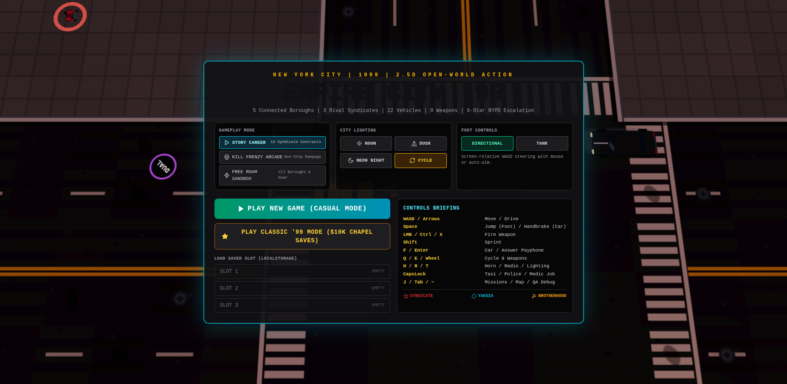
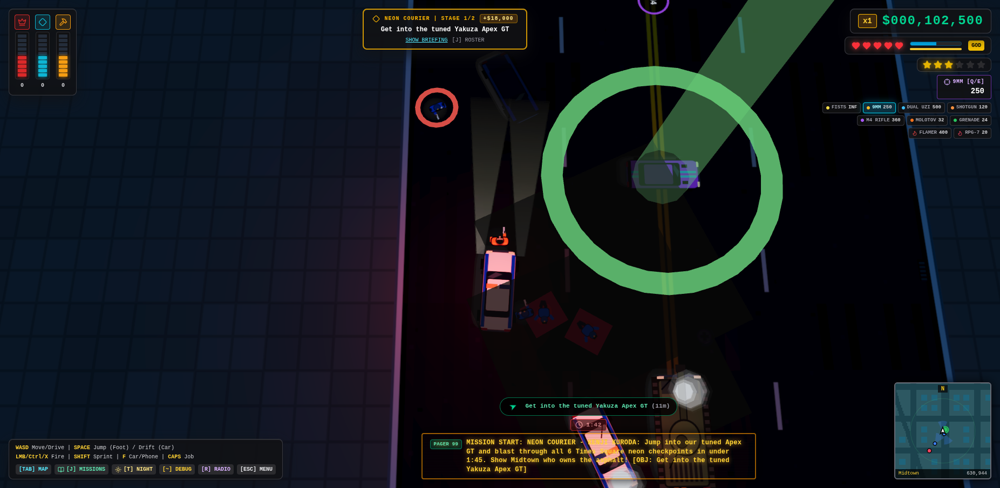
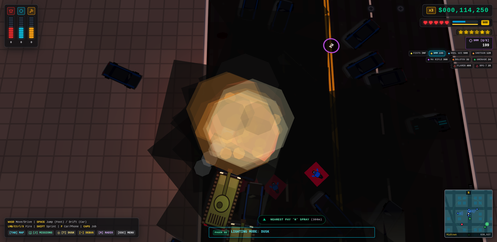
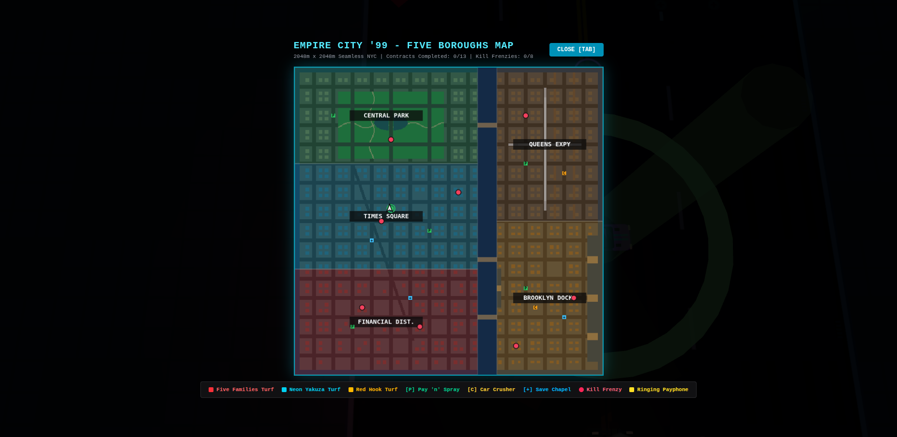

# Empire City '99 — 2.5D Open-World GTA 2 Browser Game

[](./LICENSE)
[](https://www.typescriptlang.org/)
[](https://threejs.org/)
[](https://rapier.rs/)
[](https://vitejs.dev/)
[](#-requirements--supported-os)

**Empire City '99** is an open-source, 100% browser-playable **2.5D top-down open-world action game** inspired by *Grand Theft Auto 2 (1999)*, set in a seamless **2048m × 2048m procedural New York City** map.

All 3D buildings, neon signs, asphalt streets, vehicles, characters, and sound effects (engine RPM synthesis, tire screeches, sirens, weapons, and synthwave radio) are procedurally generated in real time with **Three.js**, **HTML5 Canvas**, **Rapier2D WASM physics**, and the **Web Audio API** — with **zero external asset dependencies** and zero backend required.

---

## Screenshots

| Title Screen & Modes | Midtown & Times Square (Neon Night) |
| :---: | :---: |
|  |  |

| High-Speed Chase, Weapons & Wanted Stars | Seamless 5-Borough NYC Map |
| :---: | :---: |
|  |  |

---

## Key Features

- **Seamless 5-Borough NYC World (`2048m × 2048m`)**: Financial District & Little Italy, Midtown & Times Square, Central Park, Brooklyn Docks & Red Hook, and Queens Rail Yards & Elevated Expressway — streamed smoothly via a 49-chunk LRU cache.
- **22 GTA 2-Inspired Vehicles**: Metro Yellow Cab, Mobster V8, Apex GT, Red Hook Muscle, V8 Stallion, Syndicate Limo, NYPD Interceptor, SWAT Enforcer, Federal Interceptor, FDNY Ambulance & Fire Truck (with water cannon), Empire Box Truck, MTA City Bus, National Guard Rhino Tank, Syndicate Z-Type, Michelli Roadster GT, Dementia Micro Bug, G4 Bullion Bank Van, Mister Frosty Van, and more.
- **Arcade-Drift Physics, Damage & Chain Explosions**: Speed-sensitive steering, Spacebar handbrake drifts with tire skids, vehicle-to-vehicle and obstacle collision damage, pedestrian run-over kills & scoring, and **chain-reaction explosions** across adjacent vehicles.
- **On-Foot Combat & Spacebar Car Jump**: Simultaneous multi-key movement (Directional or Classic Tank mode), **Spacebar jump over parked/moving cars**, and **9 weapons** (Brass Knuckles, 9mm Pistol, Dual Micro-Uzis with drive-by support, Pump Shotgun, M4 Rifle, Molotov Cocktails, Frag Grenades, Flamethrower, RPG-7).
- **3 Rival Syndicates & Respect-O-Meters**: Five Families Syndicate, Neon Yakuza Cartel, and Red Hook Brotherhood — dynamic gang turf hostility, Green/Yellow/Red payphone contracts, **13 scripted missions** (including *King of the Five Boroughs* finale), **8 Kill Frenzies**, and repeatable **Taxi / Vigilante / Paramedic** side jobs.
- **6-Star NYPD Escalation**: Beat cops, PIT-maneuver interceptors, roadblocks with spike strips, SWAT vans, FBI SUVs, and National Guard Rhino Tanks.
- **3 Game Modes & 4 Lighting Modes**: *Story Career* (Casual or Classic '99), *Kill Frenzy Arcade*, and *Free Roam Sandbox*, paired with live *Noon*, *Dusk*, *Neon Night*, and *Cycle* lighting.
- **Procedural Audio & Persistence**: Real-time Web Audio API SFX + 3 procedural radio stations (`NEON SYNTH 99`, `HEAD RADIO 98.7`, `FUNK FM 101.5`) and multi-slot `localStorage` save/load.

---

## Requirements & Supported OS

| Component | Requirement |
| :--- | :--- |
| **Operating System** | **Windows** 10 / 11, **macOS** 12+, or **Linux** (Ubuntu, Debian, Fedora, Arch) |
| **Runtime** | **Node.js `>= 18` LTS** (with `npm >= 9`) |
| **Browser** | Any modern WebGL-capable browser (**Chrome**, **Edge**, **Firefox**, **Safari**) |
| **Backend / Assets** | None — 100% client-side, local-first static app |

---

## Quick Start (Install & Play)

```bash
# 1. Clone the repository
git clone https://github.com/Meysam-sadeghi/empire-city-99-gta2.git
cd empire-city-99-gta2

# 2. Install dependencies
npm install

# 3. Start local development server
npm run dev
```

Open **`http://localhost:5173/`** in your browser and press **PLAY**.

### Static Production Build (For Online Hosting)

Deploy the generated `dist/` folder directly to **GitHub Pages**, **Vercel**, **Netlify**, or **Cloudflare Pages**:

```bash
npm run build      # Type-checks and outputs static bundle to dist/
npm run preview    # Locally previews production build at http://localhost:4173/
```

---

## Controls

| Key / Input | Action |
| :--- | :--- |
| `W A S D` / `Arrow Keys` | Move (On Foot) / Accelerate, Brake & Steer (In Vehicle) |
| `Space` | **Jump over cars** (On Foot) / **Handbrake Drift** (In Vehicle) |
| `Left Click` / `Ctrl` / `X` | Fire Weapon / Drive-By / Tank Cannon & Firetruck Water Cannon |
| `Shift` | Sprint |
| `F` / `Enter` | Enter, Hijack, or Exit Vehicle / Answer Payphone |
| `Q` / `E` / `Mouse Wheel` | Cycle Weapons |
| `H` / `R` / `T` | Horn & Sirens / Cycle Radio Station / Cycle Lighting Mode |
| `CapsLock` | Start / Stop Taxi, Vigilante, or Paramedic Side Job |
| `J` / `Tab` / `~` | Mission Journal / Full NYC Map / QA Debug Console |
| `Esc` | Pause & Multi-Slot Save/Load Menu |

---

## Tech Stack

- **Engine & Simulation**: Fixed 60Hz deterministic loop (`TypeScript` strict mode) + `@dimforge/rapier2d-compat` (WebAssembly rigid-body physics)
- **Renderer**: `Three.js` 2.5D hybrid top-down WebGL renderer with procedural `Canvas` textures, dynamic lighting, and automatic Canvas2D 2.5D fallback
- **UI & HUD**: `React 18` + `Tailwind CSS v4` + `lucide-react`
- **Audio**: Custom `Web Audio API` procedural synthesizer
- **Bundler**: `Vite 6`

---

## License

Licensed under the **[MIT License](./LICENSE)** — free for personal, educational, and commercial use.
